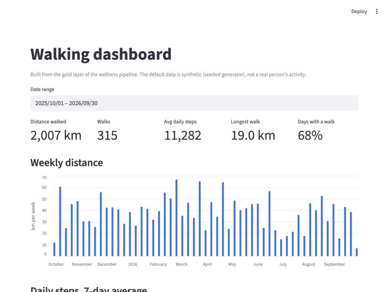
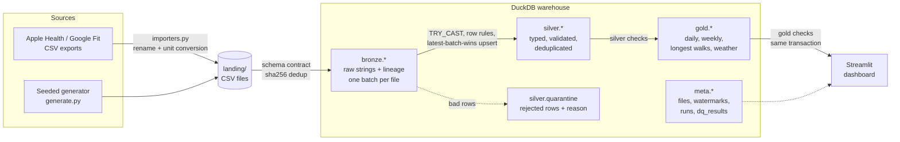

# Wellness data pipeline

A small, complete data engineering project for walking and activity data. Raw exports land
as files, move through **bronze → silver → gold** layers in DuckDB, are checked for quality at
every step, and feed a Streamlit dashboard of weekly walking totals, longest walks, and
walking vs. weather.

It runs locally in a few seconds, costs nothing, and needs only Python.



> **About the data.** By default everything is synthetic, produced by a seeded generator.
> No real person's health data is in this repository. You can import your own Apple Health or
> Google Fit export; it stays in the git-ignored `data/` folder on your machine.

## Quick start

```bash
make preview     # one command: create .venv, build the data if needed, serve http://localhost:8501
```

Or step by step:

```bash
make run         # create .venv, generate synthetic data, build every layer
make dashboard   # serve the dashboard at http://localhost:8501 (PORT=8600 to change)
make test        # unit + end-to-end tests
```

Other targets: `make incremental` (land three more weeks and load only that batch),
`make status` (runs, watermarks, quality results, quarantine), `make lint`, `make clean`.
Requires Python 3.9+ and `make`.

## Architecture



A run (`python -m wellness run`) does this, in order:

1. **Bronze.** Each new file in `landing/<dataset>/` is checked against the dataset's column
   contract and loaded as all-`VARCHAR` with `_batch_id`, `_source_file`, `_row_number` and
   `_ingested_at`. Files are identified by SHA-256, so the same content is never loaded twice,
   even under a new name.
2. **Silver.** For each dataset, only bronze batches above its watermark are read. Columns are
   cast with `TRY_CAST`, row rules are applied, rows that fail go to `silver.quarantine` with
   the reason and the full record, the rest are deduplicated on the business key (newest batch
   wins) and upserted. Watermark and data move in one transaction.
3. **Silver checks.** Table-level assertions; any `error` failure stops the run here.
4. **Gold.** Rebuilt from silver, then checked, inside one transaction. If a gold check fails,
   the transaction rolls back and the dashboard keeps reading the previous good tables.
5. **Bookkeeping.** Every run, file, watermark and check result is written to `meta.*`.

## Data model

### Landing contract (raw columns every file must have)

| Dataset | Columns | Business key |
|---|---|---|
| `walk_sessions` | session_id, start_time, end_time, duration_min, distance_km, steps, source | session_id |
| `daily_steps` | activity_date, steps, source | (activity_date, source) |
| `weather` | weather_date, temp_high_c, temp_low_c, precip_mm, condition | weather_date |

### Silver

| Table | Grain | Notable columns |
|---|---|---|
| `silver.walk_sessions` | one walk | walk_date, start_ts, end_ts, duration_min, distance_km, steps, pace_min_per_km |
| `silver.daily_steps` | day × device | steps |
| `silver.weather` | day | temp_high_c, temp_low_c, precip_mm, condition |
| `silver.quarantine` | rejected row | dataset, _batch_id, _row_number, reason, record (JSON) |

### Gold

| Table | Grain | What it answers |
|---|---|---|
| `gold.daily_activity` | calendar day (gap-filled) | steps, walks, km, minutes, longest walk, weather |
| `gold.weekly_walking` | ISO week | total km and hours, walks, active days, days over 10k steps |
| `gold.longest_walks` | top 25 walks | distance, duration, pace and the weather that day |
| `gold.walking_vs_weather` | condition or temperature band | share of days with a walk, avg km per day |

## Data quality

Two kinds of checks, deliberately separate:

**Row rules (silver).** Each rule is a SQL predicate. A row that breaks one is quarantined, not
dropped, so nothing disappears without a trace. Examples: unparseable timestamps, end before
start, distance outside 0.1–80 km, pace outside 6–30 min/km (faster is a run or a GPS glitch,
slower is someone forgetting to stop the watch), temperatures outside −50 to 55 °C, unknown
weather conditions.

**Table checks (`meta.dq_results`).** Each check is a query returning the number of offending
rows. `error` checks block the run; `warn` checks are recorded and shown on the dashboard.

| Layer | Check | Severity | Why |
|---|---|---|---|
| silver | key uniqueness for each table | error | the upsert relies on it; a duplicate key would double-count in gold |
| silver | `walk_sessions_not_empty` | error | an empty feed is an outage, not a quiet week |
| silver | `quarantine_rate_below_5pct` | error | a few bad rows are normal; many means the export format changed |
| silver | `weather_covers_walk_dates` | warn | missing weather leaves walks out of the weather analysis |
| silver | `daily_steps_cover_walk_steps` | warn | a day can't have fewer steps than its walks; flags device mismatches |
| silver | `no_sessions_overlap` | warn | overlapping walks from one source usually mean a double-recorded session |
| gold | `daily_activity_no_gaps` | error | charts and rolling averages assume one row per day |
| gold | weekly km and walk counts reconcile with silver | error | proves aggregation lost or duplicated nothing |
| gold | `longest_walks_ranked` | error | ranks are 1..n with no gaps |
| gold | `weather_buckets_cover_days` | warn | every day with weather lands in exactly one bucket |

The synthetic generator injects realistic mess on purpose (about 1% duplicate rows, about 2%
invalid rows, and revised step counts where two exports overlap), so these paths are exercised
on every run rather than only in tests.

## Design decisions

**Why medallion.** Each layer has one job and one contract. Bronze is a faithful, replayable
copy of what arrived, so a bug in a transform is fixed by re-running silver, not by asking for
the export again. Silver is where data becomes trustworthy (typed, valid, unique). Gold is
shaped for questions, so the dashboard holds no business logic.

**Why DuckDB instead of PySpark.** The data is a few thousand rows a year. PySpark would need a
JVM and add seconds of start-up to every test for no benefit at this size. DuckDB is a single
pip install, runs the whole pipeline and test suite in a couple of seconds, and keeps CI simple.
The patterns are the ones used on Spark and Databricks, so the port is mostly mechanical:

| Here | On Databricks |
|---|---|
| bronze as all-string tables with lineage columns | Auto Loader into a bronze Delta table |
| `meta.ingested_files` (SHA-256) | Auto Loader checkpoint / `COPY INTO` idempotency |
| `meta.watermarks` + `_batch_id` | Delta change data feed or Structured Streaming checkpoints |
| `INSERT OR REPLACE` after `QUALIFY row_number()` | `MERGE INTO` after a window dedup |
| row rules → `silver.quarantine` | DLT expectations with a quarantine table |
| `meta.dq_results` | DLT event log / Lakehouse Monitoring |
| `bronze`, `silver`, `gold` schemas | Unity Catalog schemas with per-layer grants |

**Why plain SQL checks instead of Great Expectations.** The checks are short SQL queries that
live next to the transforms, run in milliseconds, and are recorded in the same database the
dashboard reads. Great Expectations would add a large dependency and its own config for the
same assertions. The `Check` shape (layer, name, severity, query) ports to it directly if
the project grows.

**Why incremental silver but full-rebuild gold.** Silver is where volume would grow, so it
only touches new batches. Gold is small aggregates; rebuilding it every run means a late
correction in silver (a re-synced step count, a fixed walk) always reaches every number, with
no merge logic to get wrong.

**Why newest batch wins.** Phone and watch exports overlap and later exports contain late
syncs. Ordering by `_batch_id` (arrival order), not by a timestamp inside the data, makes the
rule deterministic and replayable.

**Why a Makefile.** Five steps in a fixed order don't need a scheduler. Each step is a
plain function (`bronze.ingest_landing`, `silver.load_all`, `gold.build`), so moving to
Prefect, Dagster or Databricks Workflows means wrapping those functions as tasks.

## Importing your own data

```bash
.venv/bin/python -m wellness import google-fit-daily      "path/to/Daily activity metrics.csv"
.venv/bin/python -m wellness import apple-health-records  path/to/records.csv
.venv/bin/python -m wellness import apple-health-workouts path/to/workouts.csv
make pipeline
```

| Format | Expected input |
|---|---|
| `google-fit-daily` | Google Takeout → Fit → `Daily activity metrics.csv` (`Date`, `Step count`) |
| `apple-health-records` | Apple Health `export.xml` records flattened to CSV: `type, sourceName, unit, startDate, endDate, value`. Step records are summed per day. |
| `apple-health-workouts` | Apple Health workouts flattened to CSV: `workoutActivityType, duration, durationUnit, totalDistance, totalDistanceUnit, startDate, endDate`. Walking and hiking only; miles and hours are converted. |

Importers only rename columns and convert units into the landing contract. Everything else
(typing, validation, dedup) happens in silver, so imported data gets exactly the same checks.
The fixtures in `tests/fixtures/` are made-up examples of each format.

## Project layout

```
src/wellness/
  config.py      landing contract (columns + keys) and paths
  generate.py    seeded synthetic data with injected mess
  importers.py   Apple Health / Google Fit adapters
  warehouse.py   DuckDB connection and meta tables
  bronze.py      contract check, hash-based idempotent ingest
  silver.py      typing, row rules, quarantine, dedup, incremental upsert
  quality.py     table-level checks
  gold.py        gold tables
  pipeline.py    one run, end to end
  cli.py         python -m wellness generate | import | run | status
dashboard/app.py Streamlit over gold + meta
tests/           unit tests per layer, end-to-end and dashboard smoke test
```

## Tests and CI

`make test` runs unit tests for each layer (type enforcement, every quarantine reason,
dedup, newest-batch-wins, watermarks, gold math on hand-built data, importer unit conversion),
end-to-end runs (re-run is a no-op, a new batch extends gold, a failing gold check leaves the
previous gold in place and marks the run failed), and a headless render of the dashboard.
GitHub Actions runs lint, tests and a full pipeline build on Python 3.9 and 3.12.
